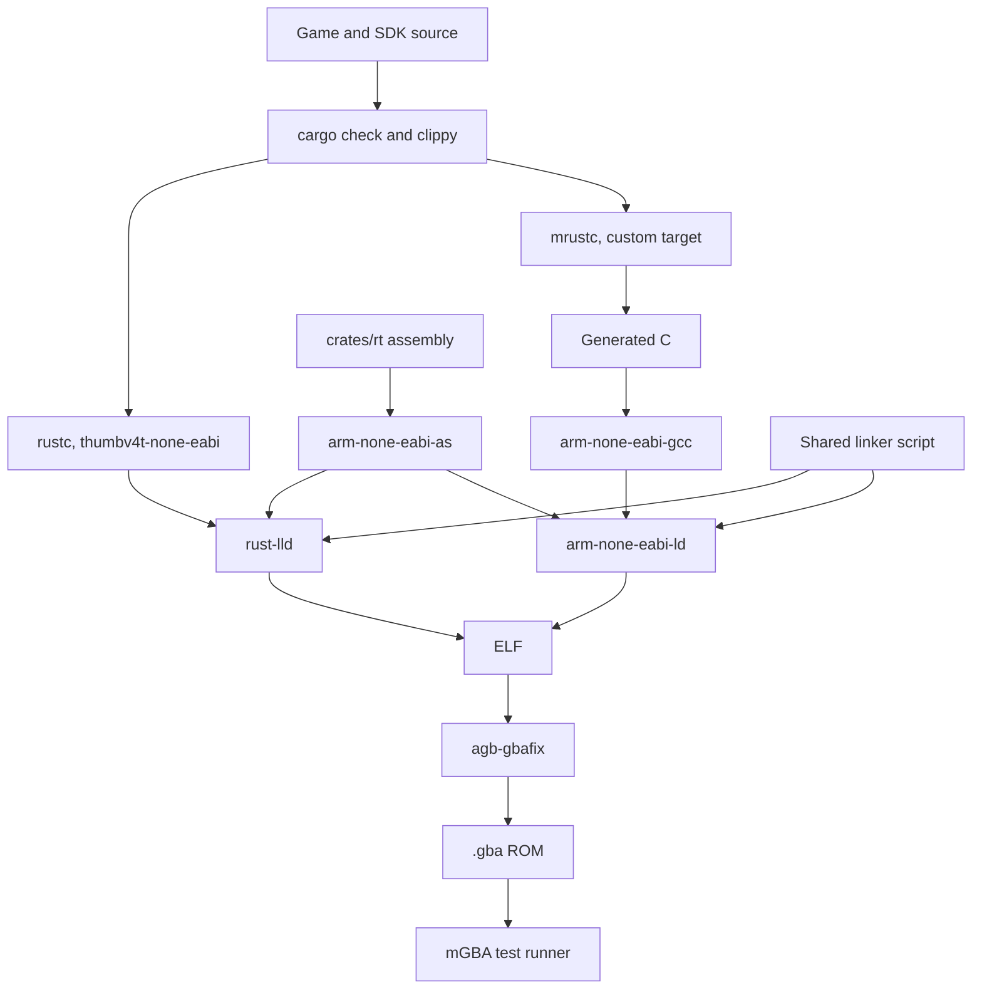

# gba

This is the Game Boy Advance SDK in the Rusty Console SDK monorepo. The root `AGENTS.md` holds the rules every SDK shares (remote builds, code quality, docs, writing style); this file adds what is specific to the GBA. Paths here are relative to `gba/`.

## Overview

gba is a Game Boy Advance SDK for Rust, to be published on crates.io as `gba-sdk` (it isn't yet). Games and the SDK itself are written in `no_std` Rust and compile through two backends from the same source. License: BSD-3-Clause.

**Status: the native half of milestone 0 is built.** A ROM boots in mGBA from `rt`'s startup code, fills the screen in mode 3, reads the buttons and logs to mGBA. Nothing in the mrustc column exists yet. Sections below marked "planned" describe intent, not code; when a part gets built, rewrite its section to describe what exists.

| Backend | Pipeline | Role | Status |
| --- | --- | --- | --- |
| native | `rustc` (LLVM) for `thumbv4t-none-eabi` | The reference. Every feature works here first. | builds and boots; `just rom`, `just test` |
| mrustc | `mrustc` to C, then `arm-none-eabi-gcc` | Second backend. Gives us GCC's code generation and a C-based build. | planned, depends on the spike (milestone 0) |

### Why mrustc is the second backend

C and GCC are the established route for GBA games, but mrustc only gives us part of that. Its output is generated C that its own README calls "very ugly", so nobody can read or maintain it as a C project. What we get from it is GCC as an optimizer and a build that doesn't depend on LLVM. Linking C libraries doesn't need mrustc at all, since both backends can link objects built by `arm-none-eabi-gcc` through `extern "C"`.

So mrustc is worth supporting, as long as it never holds the SDK back:

- mrustc's goal is bootstrapping `rustc`, and it assumes the code it receives is valid. It has no borrow checker, so `rustc` checks all code first, on both backends.
- If the two backends disagree, treat it as an mrustc or SDK bug until shown otherwise. The native result is the expected one.
- Native never waits on mrustc. If a feature can't work under mrustc yet, record that in the feature table in `docs/` and move on.
- We do not contribute to mrustc: no pull requests, no issues. Fixes we need stay local (see The mrustc backend).

### Layout

Each crate has one job. The crates that end up in a ROM stay free of dependencies wherever possible, because every dependency has to compile under mrustc too. The SDK's Cargo workspace is `Cargo.toml` here. Each manifest spells out its `version`, `edition`, `rust-version = "1.90"` and path dependencies rather than inheriting them from `[workspace.package]`, since minicargo isn't known to read workspace inheritance.

- `crates/regs` (`gba-sdk-regs`): typed, volatile access to memory-mapped registers and memory. `Reg<T>` is one cell with `read` and `write`; `Block<T, N>` is a run of them (`get`, `fill`). Holds the register constants (`DISPCNT`, `VCOUNT`, `KEYINPUT`, `IME`, `MODE3_FRAME` and `MODE3_FRAME_WORDS`) and mGBA's debug registers under `mgba`. The constants over VRAM are `u16` or `u32`, since VRAM, palette RAM and OAM mishandle byte writes; `Block<u8, _>` exists only for mGBA's string buffer, so never make one over hardware memory. No policy.
- `crates/rt` (`gba-sdk-rt`): what every ROM links. `src/crt0.s` is the ROM header and startup (gas, ARM mode): the IRQ, SVC and user stacks, `.data` copied from ROM to IWRAM, `.bss` zeroed, then `bx` to `main`. `gba.ld` is the linker script: `.data` takes `.iwram*` input sections so `#[link_section = ".iwram"]` code lands in IWRAM, and the IWRAM region stops 2K short of the user stack so an oversized `.data` or `.bss` fails at link time. `src/lib.rs` has `entry!` (defines the exported `main`), the `log!` macro and `MgbaLog` over mGBA's debug registers, and the panic handler, which logs at `Fatal` and loops. Planned here: the interrupt trampoline, BIOS calls and the memory functions.
- `crates/sdk` (`gba-sdk`): the API games use. Today `video` (`Color`, `Mode3`, `wait_for_vblank`, which polls `VCOUNT`) and `input` (`Button`, `Buttons`). Re-exports `regs`, `entry!`, `log!` and `LogLevel`. It has `extern crate gba_sdk_rt` so the panic handler is always linked. Planned: interrupts, DMA, a frame loop, button edges, sprites, tiled backgrounds, typed asset handles, text, fixed-point and vector math, collision, a 2D camera, mode 4 shapes, windows and blending, timers, sound, saves. `docs/gba/roadmap.md` has the full list.
- `examples/hello`: the smallest ROM, mode 3 with a color that changes while A is held. It logs `hello from gba-sdk`, which `just test` looks for, so it doubles as the boot test.
- `tools/run-rom.sh`: runs a ROM headless in mGBA and saves the log next to it, deleting any old log first. It fails if the log can't be written, if mGBA exits or is killed before the time is up (a SIGKILL only counts as the timeout once the full time has passed), or if the log lacks an expected line. A crash inside the emulated ROM doesn't exit mGBA, so that only shows up as a missing line. `just test` calls it.
- `target/roms/`: built `.gba` files and their mGBA logs (ignored by git).
- Planned: more host programs in `tools/` (the asset converter, a test runner over libmgba, and `cargo-gba-sdk`), `targets/` for the mrustc target file and C compiler wrapper, `tests/` for ROMs that report results.
- `tools/cargo-gba-sdk` (planned): the `cargo gba-sdk` subcommand, how people using the published crate build a game. ROM crates have no build scripts, so plain `cargo build` can't assemble `crates/rt`'s `.s` files. This tool assembles, links and runs `gbafix`, on either backend, and expects `arm-none-eabi` binutils to be installed. Build logic moves here from the `just` recipes as it settles, so this repo and its users build the same way. (The name `cargo-gba` on crates.io belongs to an unrelated crate.)

### Hardware facts that shape the code

- CPU: ARM7TDMI at 16.78 MHz, ARMv4T. Thumb-1 only, no Thumb-2. No FPU, no hardware divide, no cache, no compare-and-swap.
- Memory: IWRAM 32 KB at `0x03000000` (32-bit bus, no wait states), EWRAM 256 KB at `0x02000000` (16-bit bus, slow), ROM at `0x08000000` (16-bit bus, wait states). Hot code goes in IWRAM. Thumb is the default because of the ROM's 16-bit bus; ARM mode only pays off in IWRAM.
- Video memory: palette at `0x05000000`, VRAM at `0x06000000`, OAM at `0x07000000`. Byte writes misbehave in all three (a VRAM or palette byte write is duplicated across the halfword, an OAM byte write is ignored). The `regs` API must not allow 8-bit writes there, and it must not let `memcpy` do them either.
- Interrupts: the BIOS dispatches to a handler whose address is stored at `0x03007FFC`, and it enters that handler in ARM mode.
- ROM header: 192 bytes, starting with an ARM branch to the entry point. A ROM needs its header checksum fixed (`agb-gbafix`) before it boots on hardware.

## Building and testing

Builds run on the remote build server; the root `AGENTS.md` says how.

### Toolchain

- Rust: `rust-toolchain.toml` pins `nightly-2026-10-15` with `rust-src`, `clippy` and `rustfmt`, installed by rustup on the first `cargo` call. `thumbv4t-none-eabi` is a Tier 3 target with no prebuilt `core`, so it needs `-Zbuild-std=core`, and that needs nightly. The recipes pass it (with `-Zbuild-std-features=compiler-builtins-mem`, which supplies `memcpy` and friends until `rt` does) rather than `.cargo/config.toml`, which would rebuild std for host tools too. `.cargo/config.toml` holds only the `[target.thumbv4t-none-eabi]` rustflags: `-Ctarget-cpu=arm7tdmi`, the linker script and the assembled `crt0.o`. Their paths are relative to `gba/`, the workspace root, which is where cargo runs rustc.
- The GBA's tools in the root `mise.toml`: `github:xpack-dev-tools/arm-none-eabi-gcc-xpack` 15.2.1-1.1 (mise picks the right asset by itself) and `cargo:agb-gbafix` 0.25.0. Avoid mise's `gcc-arm-none-eabi` entry, which stops at 13.3.
- mrustc (planned): built from a pinned commit into a directory ignored by git. The commit lives in one file, and bumping it is its own change.
- Emulator: mGBA 0.10.5, the `mgba-sdl` package on the server, run under `xvfb-run`.

### Commands

This `justfile` is the root's `gba` module, so from the root these are `just gba::check` and so on, and `just remote gba::check` runs one on the build server. Inside `gba/` the prefix can be dropped. Recipes run in `gba/` and hold no logic beyond running things; logic goes in `tools/`.

- `just asm`: assembles `crates/rt/src/crt0.s` into `target/rt/crt0.o`. The other recipes run it first.
- `just check`: `cargo fmt --check` and `clippy` for the target with warnings denied. Not `--all-targets`: test harnesses need `std`, which the target doesn't have.
- `just rom <name>`: builds one ROM with the native backend into `target/roms/<name>.gba` (`agb-gbafix` reads the ELF and writes the fixed ROM in one step) and prints its section sizes. Planned: `just rom-c <name>` through mrustc.
- `just test [name] [expect]`: builds the ROM and runs `tools/run-rom.sh`, which runs it for four seconds in headless mGBA and greps its log for `expect` (default: hello's line). In the script, `timeout` is mGBA's direct parent with `-k` because mGBA ignores SIGTERM, and `stdbuf -oL` keeps the log flowing through the pipe; without both it hangs. Planned: every test ROM on both backends.
- `just run <name>`: builds remotely through the root's `remote` recipe, fetches the ROM, opens it in local `mgba-qt`.
- Planned: `just compare` for ROM size and cycle counts per backend, and `just test-host` for the host `cargo test` of pure logic such as fixed-point math.

### Testing

- Add a test with every behavior change.
- Compile a docs snippet as its own example crate, never by swapping in an existing example's source. `rsync -a` puts the original file back with its old mtime, so cargo keeps the snippet's binary and `just test` runs the wrong ROM.
- Pure logic (fixed-point math, asset parsing) gets ordinary `cargo test` on the host. Keep it in modules that don't touch hardware. Nothing has this yet.
- Anything touching hardware is a ROM that runs in mGBA and reports through `log!`. Today that is `examples/hello` through `just test`. Planned: ROMs in `tests/` through `tools/test-runner`, which wraps libmgba and reads results through mGBA's debug output registers. agb's `emulator/test-runner` is the model. Check agb's license before copying from it.
- The same ROM source runs under both backends with the same expected results. A test that only passes on one backend gets marked with a linked reason, not deleted.
- Rendering tests compare frames against goldens in `tests/golden/`. Goldens are shared across backends since the output must match exactly. Regenerate one only on purpose, look at it, and say why in the commit.
- Emulators are not hardware. Timing-sensitive features (sound, DMA, save media) also need a run on a real GBA with a flash cart before they are called done. Say so when that hasn't happened.

## The rules both backends impose

These decide what SDK code can look like. Code that breaks one usually still compiles on native and fails later on mrustc, so check for them in review.

- **Language floor.** mrustc's newest tested `rustc` source is 1.90. Set `rust-version = "1.90"`, and use no `#![feature]` and no language or `core` feature newer than that, even though native builds on nightly. The nightly is there for `build-std`, not for features.
- **Assembly lives in `.s` files.** ARM-mode code, the interrupt trampoline, BIOS calls and fast copies are all GNU `as` (gas) files in `crates/rt`, assembled by `arm-none-eabi-as` with `.syntax unified` and `.cpu arm7tdmi` and linked the same way on both backends. Each function states its mode with `.arm` or `.thumb`. Don't use `asm!`, `global_asm!`, `#[naked]` or `#[instruction_set]`. mrustc's register class table has no ARM entries, and its `global_asm!` can't interpolate. It also compiles a whole crate with one mode, so a single function can't switch to ARM mode.
- **The ABI boundary is `extern "C"`.** Rust's ABI differs between the backends. Everything linked into one ROM's Rust side comes from one backend, and only assembly and C objects are shared.
- **No proc macros or build scripts in ROM crates.** Assets are converted ahead of time by `tools/` and pulled in with `include_bytes!`. Macros by example are fine.
- **Keep manifests simple.** minicargo reads a subset of what Cargo does. Plain `[package]`, `[dependencies]` and `[features]` until the spike shows what else works.
- **No atomics that need compare-and-swap.** Data shared with interrupt handlers uses volatile access and short critical sections through `IME`.
- **Panics abort.** No unwinding on either backend. The panic handler lives in `rt`, and writes to mGBA's debug output and halts.
- **Memory functions come from `rt`.** Both `memcpy` and `__aeabi_memcpy` style names, since GCC and LLVM call different ones. Until `rt` has them, the native backend uses `compiler_builtins`' `mem` feature. Division and other arithmetic helpers come from libgcc or `compiler_builtins`.
- **Backends stay out of the API.** No `cfg` for the backend outside `crates/rt` and `targets/`. If `crates/sdk` needs to know which compiler it's on, the abstraction is in the wrong place.

## The mrustc backend

Read from mrustc's source as of 2026-11 and not yet tested on this project. The spike replaces this list with what actually happens.

- The target is a custom file, `targets/gba.toml`, passed as `--target ./targets/gba.toml`. It sets a custom `[arch]` (mrustc's built-in ARM32 claims 8-bit, 32-bit and pointer atomics, which ARMv4T can't compare-and-swap) and `[backend.c]` options such as `-mthumb -mcpu=arm7tdmi -mthumb-interwork -mfloat-abi=soft -ffreestanding`.
- mrustc adds `-fPIC` after our options, so we can't turn it off from the target file, and position-independent code is wasted on a ROM with fixed addresses. It also turns `-O2` into `-O1` as a workaround for its issue #347. `targets/mrustc-cc`, set through the `CC_arm_none_eabi` variable that mrustc checks first, drops `-fPIC` and controls the optimization level. Try `-O2` and let the tests decide.
- `#[link_section]` reaches the C output for statics, but the C backend doesn't appear to emit it for functions. A function marked for IWRAM would silently stay in ROM: it still works, only slower. Until that's fixed, a test asserts that each IWRAM function's address really is in IWRAM, on both backends.
- Carry local fixes as patch files in `targets/mrustc-patches/`, applied to the pinned commit, and keep them few and small. The IWRAM problem above is the likely first one. Use the C wrapper or the target file instead when either can do the job.
- Only `core` (and `alloc` if we offer it) gets built for the target, not `std` or `rustc`. That's what keeps it practical on the server.
- Debug with `MRUSTC_DEBUG` and the `_dbg.txt` files mrustc writes next to its output. Assume code that reaches mrustc is valid: its error messages are poor, and it may accept what `rustc` rejects.

## Suggested build order

Prove the riskiest assumption first, then build outward. Each milestone ends with ROMs that pass on every backend in play: native always, mrustc once the spike says go. After a no-go, mrustc stays experimental and the "both backends" requirements mean native only. The numbers match `docs/gba/roadmap.md`. Its checklists are the full list and the summaries here are the outline, so a change to one goes into the other.

The API aims to feel like a small raylib: a frame loop, `draw_sprite` and `draw_text` calls every frame, converted assets behind typed handles, and math types for movement and collision. Drawing goes through the sprite and tile hardware, not pixels, since clearing the mode 3 frame buffer alone costs about half a frame. Games write a RAM copy of OAM and the frame loop copies it over in the vertical blank.

- **Milestone 0: the spike, the go/no-go for mrustc.** The smallest possible ROM (mode 3, fill the screen, read a key) with `rt`'s startup and linker script, on native first: done, that is `examples/hello`. Then build `core` 1.90 with mrustc for the custom target and get the same ROM to boot in mGBA. Confirm `arm-none-eabi-gcc -mthumb -mcpu=arm7tdmi` finds a suitable libgcc multilib. Record ROM size and frame cost for both. **Go** if the ROM boots and the size and speed are in a usable range. **No-go** means mrustc stays marked experimental and the native SDK carries on. The rest of the spike runs alongside milestone 1, since native never waits on mrustc.
- **Milestone 1: foundations.** The test runner, interrupts and `VBlankIntrWait`, DMA, the frame loop (sleeping until the vertical blank, a frame counter, a queue of copies that milestone 2 fills), button edges, fixed-point math with the first host tests, a `log!` that is safe to interrupt, panics on screen and in the log, memory functions in `rt`, and a test that `.iwram` functions really are in IWRAM. CI from here on.
- **Milestone 2: graphics.** Sprites through the RAM copy of OAM, tiled backgrounds with scrolling and streaming of big maps, palettes, a VRAM allocator with typed asset handles, a built-in text font, the asset converter for images and Tiled maps (its output 4-byte aligned for DMA), and frame comparisons against goldens. It ends with a small game (Breakout or similar) in `examples/`, so the API gets a user early.
- **Milestone 3: game loop essentials.** `Vec2`, `Rect` and collision, a sine table and an RNG, a 2D camera, mode 4 shape drawing, windows and blending, timers, an optional allocator over EWRAM.
- **Milestone 4: sound and saves.** PSG sound effects, then Direct Sound with a mixer in IWRAM and WAV conversion, which is the heaviest test of the IWRAM and ARM-mode story, then music. Saves: SRAM first, then flash and EEPROM.
- **Milestone 5: a real game.** A small complete game in `examples/`, built on both backends, as the proof that the API holds up. Then `cargo gba-sdk`, publishing, and a hardware run.

CI (planned) runs on GitHub Actions without the build server: `just check` and `just test` for native on every push. It belongs to milestone 1, once there's something to protect. The mrustc build joins it after a go, cached by its pinned commit.

## Code Quality

On top of the root's rules:

- `crates/regs` and `crates/rt` hold the unsafe code, and `crates/sdk` offers games a safe API wherever the hardware allows.
- No floats in the SDK. They run in software and they're slow. Use fixed point.
- Mind the 32-bit target: `usize` is 32 bits, 64-bit math is slow, and integer division calls a helper. Prefer shifts in hot paths.
- Keep ROM and IWRAM use in mind. Generics and `core::fmt` pull in a lot of code, so check `just compare` when adding either to a common path.
- While mrustc is in play, a dependency for a ROM crate has to build under it. Once mrustc can build a ROM, test a dependency there before adding it. Until then, avoid one where you can, and if native work needs one first, note it for the spike to check. After a no-go this rule lapses.

Existing crates ([agb](https://github.com/agbrs/agb), [gba](https://github.com/rust-console/gba)) are useful references, especially for hardware quirks. We don't depend on them, since neither targets mrustc and both assume nightly features. Check the license before copying code. The name `gba` on crates.io belongs to that second crate, so ours is `gba-sdk`.

## Docs

The root `AGENTS.md` has the docs rules. The GBA's pages are in `docs/gba/` at the root, under the "Game Boy Advance" section of `zensical.toml`'s `nav`:

- `index.md`: what gba-sdk is, with the hello example, and the status.
- `getting-started.md`: installing, building and running the example, writing a ROM, remote builds.
- `video.md`, `input.md`, `logging.md`: one page per hardware area the SDK covers, each describing every public item of its module. A new module gets a page and a `nav` entry.
- `runtime.md`: what `rt` does before `main`, `entry!`, the memory layout from `gba.ld`, IWRAM placement.
- `backends.md`: the two backends, the pipeline diagram, mrustc's constraints, and the table of what works on each. A feature that only works on one backend gets a row with the reason.
- `development.md`: toolchain, layout, the commands table (keep it in step with `gba/justfile`), testing, docs.
- `roadmap.md`: the milestones from this file as checklists.

Whole programs in the docs are compiled as ROMs, on both backends once mrustc exists. When the layout, build, backends or tooling of the GBA SDK change, update the overview and the build section here.
